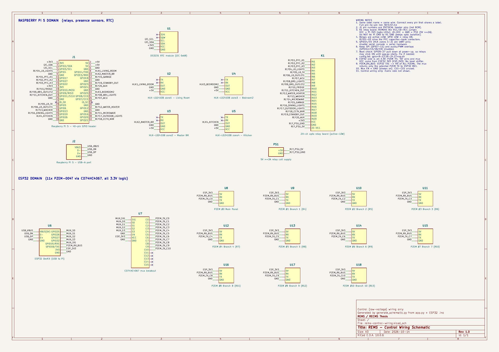

# REMS Hardware: Pin Map & Wiring

This is the single reference for every pin used by the system. Everything here comes from the code:

- **Raspberry Pi 5:** `backend/app.py` (`relay_pins`, `HLK_PINS`, `/api/rtc/sync`)
- **ESP32:** `hardware/esp32_11_pzem_multiplexer.ino`

**Wiring schematic with nets:** [`schematic/rems-control-wiring.pdf`](schematic/rems-control-wiring.pdf) (KiCad project in `schematic/`, pin-to-pin list in [`schematic/NETLIST.md`](schematic/NETLIST.md)).
If you change a pin in code, regenerate it: `python3 hardware/schematic/generate_schematic.py` (then export the PDF from KiCad or `kicad-cli sch export pdf`), and update the tables below.



```
                         USB (/dev/ttyUSB0, 115200 baud, JSON lines)
 ┌──────────────────┐◀───────────────────────────────────────────┐
 │  Raspberry Pi 5  │                                            │
 │  Flask + SQLite  │──GPIO──▶ 20-ch relay board (active-LOW)    │
 │                  │◀─GPIO─── 4× HLK-LD2410B presence sensors   │
 │                  │◀─I2C──── DS3231 RTC (0x68)                 │
 └──────────────────┘                                     ┌──────┴──────┐
                                                          │    ESP32    │
                                       S0–S3 ┌───────────▶│ GPIO25/26/  │
                                             │            │ 27/32       │
                      ┌──────────────────────┴─┐  SIG     │ GPIO19 RX1  │
 PZEM #0..#10 TX ────▶│ CD74HC4067 C0..C10     │─────────▶│             │
                      └────────────────────────┘          │ GPIO18 TX1  │
 PZEM #0..#10 RX ◀──── shared bus (3.3V) ◀───────────────│             │
                                                          └─────────────┘
```

---

## 1. Raspberry Pi 5: 40-pin header

**Every user GPIO (2–27) is in use.** There are no spare GPIOs for extra sensors, an IR blaster, buzzers, etc. (see [Section 6](#6-known-gaps)).

| Phys | BCM | Function | | Phys | BCM | Function |
|---:|---|---|---|---:|---|---|
| 1 | 3V3 | DS3231 VCC, HLK/relay logic ref. | | 2 | 5V | HLK-LD2410B VCC |
| 3 | GPIO2 | **DS3231 SDA** (I2C1) | | 4 | 5V | (5V spare) |
| 5 | GPIO3 | **DS3231 SCL** (I2C1) | | 6 | GND | |
| 7 | GPIO4 | **Relay 4**: Living Room Lights | | 8 | GPIO14 | **HLK zone 1**: Living Room ⚠️ UART TX |
| 9 | GND | | | 10 | GPIO15 | **HLK zone 2**: Master Bedroom ⚠️ UART RX |
| 11 | GPIO17 | **Relay 1**: PFC Capacitor Bank K1 | | 12 | GPIO18 | **Relay 15**: Garage Door & Lights |
| 13 | GPIO27 | **Relay 2**: PFC Capacitor Bank K2 | | 14 | GND | |
| 15 | GPIO22 | **Relay 3**: PFC Capacitor Bank K3 | | 16 | GPIO23 | **Relay 19**: Standby Outlets |
| 17 | 3V3 | | | 18 | GPIO24 | **Relay 20**: Auxiliary Branch |
| 19 | GPIO10 | **Relay 10**: Refrigerator (critical) | | 20 | GND | |
| 21 | GPIO9 | **Relay 9**: Bedroom 1 Outlet Group 2 | | 22 | GPIO25 | **HLK zone 3**: Bedroom 2 |
| 23 | GPIO11 | **Relay 11**: Kitchen Outlets | | 24 | GPIO8 | **Relay 8**: Bedroom 1 Lights |
| 25 | GND | | | 26 | GPIO7 | **Relay 7**: Air Conditioner (ACU) |
| 27 | ID_SD | Reserved (HAT EEPROM), don't use | | 28 | ID_SC | Reserved (HAT EEPROM), don't use |
| 29 | GPIO5 | **Relay 5**: Living Room TV | | 30 | GND | |
| 31 | GPIO6 | **Relay 6**: Outlet Group 1 | | 32 | GPIO12 | **Relay 12**: Water Heater |
| 33 | GPIO13 | **Relay 13**: Washing Machine | | 34 | GND | |
| 35 | GPIO19 | **Relay 16**: Dining Room Lighting | | 36 | GPIO16 | **Relay 14**: Microwave Oven |
| 37 | GPIO26 | **HLK zone 4**: Kitchen | | 38 | GPIO20 | **Relay 17**: Outdoor Security Lights |
| 39 | GND | | | 40 | GPIO21 | **Relay 18**: CCTV / NVR (critical) |

USB-A port: ESP32 (appears as `/dev/ttyUSB0` or `/dev/ttyACM0`; `app.py` also tries `ttyUSB1` and `ttyACM1`).

## 2. Relay board (20 channels, active-LOW)

`gpiozero.OutputDevice(pin, active_high=False)`: GPIO **LOW = relay ON**, HIGH = OFF.

| Relay | BCM | Phys | Load | Room | Notes |
|---:|---|---:|---|---|---|
| 1 | GPIO17 | 11 | PFC Capacitor Bank K1 | Main Panel | via CJX2-1210 contactor; ACU interlock |
| 2 | GPIO27 | 13 | PFC Capacitor Bank K2 | Main Panel | via CJX2-1210 contactor; ACU interlock |
| 3 | GPIO22 | 15 | PFC Capacitor Bank K3 | Main Panel | via CJX2-1210 contactor; ACU interlock |
| 4 | GPIO4 | 7 | Living Room Lights | Living Room | default motion-linked load |
| 5 | GPIO5 | 29 | Living Room TV | Living Room | |
| 6 | GPIO6 | 31 | Outlet Group 1 | Living Room | |
| 7 | GPIO7 | 26 | Air Conditioner Main (ACU) | Master Bedroom | turning ON forces K1–K3 OFF |
| 8 | GPIO8 | 24 | Bedroom 1 Lights | Master Bedroom | |
| 9 | GPIO9 | 21 | Bedroom 1 Outlet Group 2 | Master Bedroom | |
| 10 | GPIO10 | 19 | Refrigerator | Kitchen | **critical**: never auto-cut |
| 11 | GPIO11 | 23 | Kitchen Outlets | Kitchen | |
| 12 | GPIO12 | 32 | Water Heater | Bathroom | |
| 13 | GPIO13 | 33 | Washing Machine | Laundry Area | |
| 14 | GPIO16 | 36 | Microwave Oven | Kitchen | |
| 15 | GPIO18 | 12 | Garage Door & Lights | Garage | |
| 16 | GPIO19 | 35 | Dining Room Lighting | Dining Room | |
| 17 | GPIO20 | 38 | Outdoor Security Lights | Outdoor / Garden | |
| 18 | GPIO21 | 40 | CCTV / Security NVR | Main Panel | **critical**: never auto-cut |
| 19 | GPIO23 | 16 | Standby Outlets | Living Room | |
| 20 | GPIO24 | 18 | Auxiliary Branch | Main Panel | |

Room names are editable in the app; the table shows the seeded defaults.

**Board power:** remove the `JD-VCC` jumper. Connect board `VCC` to Pi **3V3** (opto LED side) and `JD-VCC` to a **separate 5V supply** (20 coils draw about 1.4 A, more than the Pi can provide). Connect that supply's GND to the board's `GND`, and **don't** connect Pi GND to the relay board GND, so the optocouplers keep the Pi isolated from the coil supply. A board with `VCC` at 5V driven by 3.3V GPIO may not switch fully OFF, which is why `VCC` goes to 3V3.

### 2.1 Electrical 3-way lights (relay + wall switch)

Relays **4, 8, 15, 16, 17** (the lights) are wired as **3-way** circuits, so the physical wall switch still works and the app can also switch the light. The relay's SPDT contact (COM / NO / NC) takes the place of one of the two 3-way switches:

```
            relay channel (SPDT)              wall switch (SPDT, "3-way")
  L ──────── COM                                         COM ──────── lamp ──────── N
              ├── NO ──────── traveler A ──────── A ──┤
              └── NC ──────── traveler B ──────── B ──┘
```

Flipping **either** the relay or the wall switch toggles the lamp. Because of that, the relay position no longer tells you whether the light is on:

- The apps send **TOGGLE** for lights instead of ON/OFF (`POST /api/relay {"action": "toggle"}`).
- The real light state is read from the branch PZEM current. Above `LIGHT_ON_CURRENT_A` (0.02 A in `app.py`) means the lamp is lit.
- Automation (AI-Assist, Security, turn-off-all) checks that sensed state and toggles only when the lamp is in the wrong state.

| Relay | Light | PZEM channel | Light state shown in the app |
|---|---|---|---|
| 4 | Living Room Lights | C1 | sensed from current |
| 8 | Bedroom 1 Lights | C5 | sensed from current |
| 15 | Garage Door & Lights | (none) | **estimate** ("est.") |
| 16 | Dining Room Lighting | (none) | **estimate** ("est.") |
| 17 | Outdoor Security Lights | (none) | **estimate** ("est.") |

Relays 15–17 have no dedicated PZEM, so the app falls back to the relay position. That estimate is wrong after someone uses the wall switch. To sense them for real, give each one its own PZEM channel and update `RELAY_CHANNEL_MAP` in `app.py`.

⚠️ **This is the mains side.** It is outside the control-wiring schematic. Check that the relay contacts are rated for the lamp load (typically 10 A 250 VAC), and have a licensed electrician do or check the wiring.

## 3. Presence sensors: 4× HLK-LD2410B (24 GHz mmWave)

`gpiozero.DigitalInputDevice(pin, pull_up=False)`: OUT HIGH = presence.

| Zone | BCM | Phys | Area | Sensor pins |
|---|---|---:|---|---|
| zone1 | GPIO14 | 8 | Living Room (primary tested sensor) | VCC→5V, GND→GND, OUT→GPIO |
| zone2 | GPIO15 | 10 | Master Bedroom | same |
| zone3 | GPIO25 | 22 | Bedroom 2 | same |
| zone4 | GPIO26 | 37 | Kitchen | same |

HLK-LD2410B OUT is a 3.3V signal, so it connects straight to the Pi.

## 4. DS3231 RTC (I2C, address 0x68)

| DS3231 | Pi |
|---|---|
| VCC | Pin 1 (3V3) |
| GND | Pin 9 (GND) |
| SDA | Pin 3 (GPIO2) |
| SCL | Pin 5 (GPIO3) |

Enable with `dtparam=i2c_arm=on` and `dtoverlay=i2c-rtc,ds3231` in `/boot/firmware/config.txt`. `/api/rtc/sync` runs `hwclock -s`.

## 5. ESP32 + CD74HC4067 + 11× PZEM-004T v3.0

One shared UART reads 11 PZEMs. The ESP32 TX goes to **all** PZEM RX pins, and the mux selects which PZEM TX is routed back to the ESP32 RX.

| ESP32 | Connects to | Purpose |
|---|---|---|
| GPIO25 | CD74HC4067 **S0** | channel select bit 0 |
| GPIO26 | CD74HC4067 **S1** | channel select bit 1 |
| GPIO27 | CD74HC4067 **S2** | channel select bit 2 |
| GPIO32 | CD74HC4067 **S3** | channel select bit 3 |
| GPIO19 (UART1 RX) | CD74HC4067 **SIG** | selected PZEM's TX |
| GPIO18 (UART1 TX) | **every** PZEM RX (direct, 3.3V) | Modbus request (shared bus) |
| USB | Raspberry Pi USB | JSON telemetry @ 115200 baud |
| 3V3 / GND | mux VCC / GND, every PZEM TTL `5V` / GND pin | whole ESP32 side runs at 3.3V |

| CD74HC4067 | Connects to |
|---|---|
| C0 | PZEM #0 TX: **Main Panel** |
| C1 – C10 | PZEM #1 – #10 TX: **Branch 1 – 10** |
| C11 – C15 | unused (tie to GND or leave open) |
| EN | GND (always enabled; not driven by code) |
| VCC / GND | ESP32 3V3 / GND |

**Branch ↔ relay mapping used by the software:** branch `Cn` is treated as the circuit of **relay n+3** (C1 = Relay 4 … C10 = Relay 13). Relays 1–3 and 14–20 have no dedicated PZEM (see FIX_PLAN.md LOGIC-2).

**Firmware timing:** 20 ms mux settle, 35 ms between channels, 400 ms between full sweeps, so all 11 channels are read about every 1 s. `voltage < 10 V` or NaN reports the channel as `STANDBY`.

Serial line format (one per channel):
```json
{"channel":0,"status":"ONLINE","voltage":228.6,"current":11.34,"power":2077.2,"pf":0.81,"freq":60.0,"energy":22.09}
```

## 6. Known gaps

- **No spare GPIO.** The thesis design (`docs/DETAILS NG IPAPACODE.pdf`) also mentions RCWL-0516 and HC-SR501 PIR sensors and IR control of the ACU. None are in the code, and there are no free pins for them. Options: a GPIO expander on I2C (e.g. MCP23017 on the existing GPIO2/3 bus) or moving sensors to the ESP32.
- **ACU uses a relay (Relay 7), not IR** as the PDF describes.
- **PZEM TTL side runs at 3.3V** (its `5V` pin is fed from ESP32 3V3), so PZEM TX, the mux and the ESP32 all stay at 3.3V and no level shifter is needed. If a PZEM reads unreliably at 3.3V, the fallback is 5V PZEM + 5V mux with level shifters on S0–S3, TX and SIG; ask before rewiring.

## 7. Pi setup checklist (things the pin map depends on)

- [ ] **Disable the serial console and UART** (`sudo raspi-config` → Interface Options → Serial Port → login shell **No**, hardware **No**). GPIO14/15 are HLK zones 1–2, not UART.
- [ ] **Keep SPI disabled.** GPIO7–11 (SPI0) are relays 7–11.
- [ ] **Keep audio/PWM overlays off.** GPIO12/13/18/19 are relays.
- [ ] **Enable I2C + DS3231 overlay** (Section 4).
- [ ] **Hold relays OFF during boot.** At power-up the Pi's GPIO 9–27 default to pull-down, so active-LOW relay inputs on those pins may click ON until `app.py` starts. That includes the capacitor banks on GPIO17/27/22. Verify with a meter. If it happens, add to `/boot/firmware/config.txt`:
  ```
  gpio=9-13,16-24,27=op,dh
  ```
  This drives those relay pins HIGH (OFF) from the bootloader onward.
- [ ] User is in the `gpio` and `dialout` groups (`deploy/setup-cloudflare-tunnel.sh` sets this for the service).
- [ ] **Open the kiosk at `http://localhost:5000`** in Chromium with `--kiosk`, for example `chromium-browser --kiosk http://localhost:5000`. The **Exit Fullscreen** button in the top bar only appears on `localhost`. It closes that kiosk Chromium through `POST /api/kiosk/exit`, which accepts only requests from the Pi itself (tunnel and LAN requests get 403), and leaves the Pi desktop showing. REMS keeps running in the background. Run the same command again to go back to full screen.
